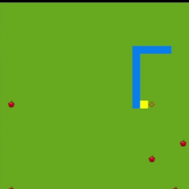
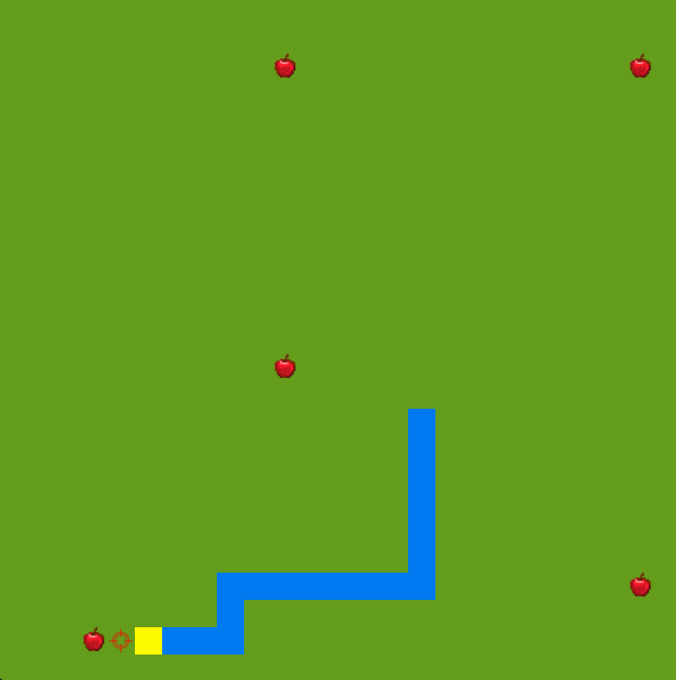
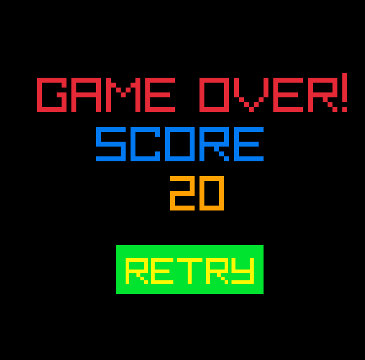

# Snake Game

**This is an implementation of Snake Game in C++ using the raylib library, it is a singleplayer game based on the classic snake game where the snake has to eat food in order to grow larger and avoid hitting the border or itself**

## How to run the game
**1. On the repository page, go to the releases and download the `.exe` file.**

**2. Double-click the `.exe` file to launch the game.**


## Rules of the game
* **Eat apples in order to grow larger**
* **Do not hit the head of the snake with it's body**
* **Do not hit the head of the snake with the wall (Window border)**

## Controls of the game
```
W -> Move Up
S -> Move Down
A -> Move Left
D -> Move Right
```

## About this specific project

* **The game is set to run at 144 Frames per second**
* **The game has a window resolution of 750x750**

  
  ## Preview

  **Snake game in action**
  
  

  ## Snapshot from the game

  

  ## Game Over Screen

   
